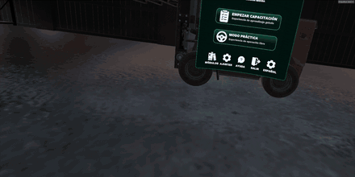
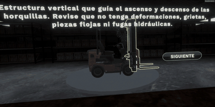
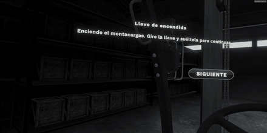
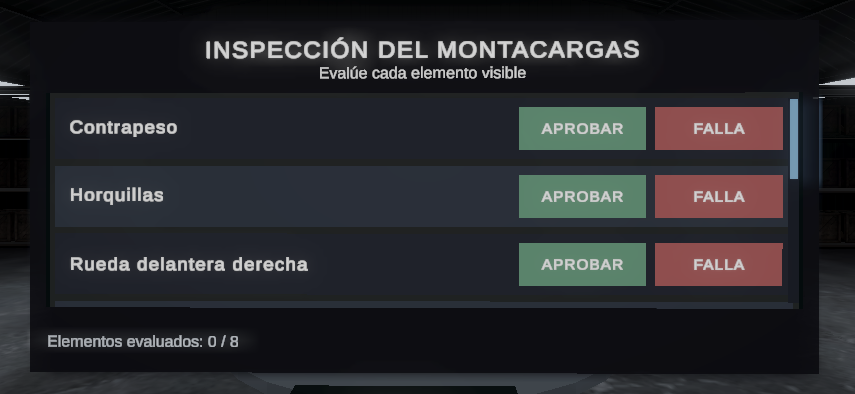
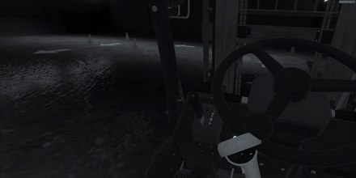
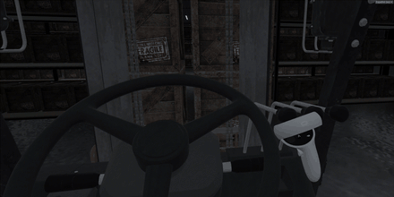
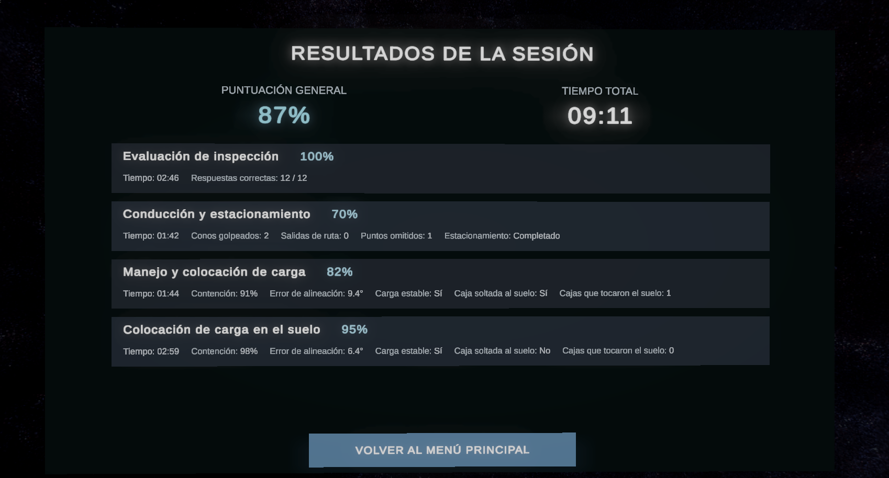
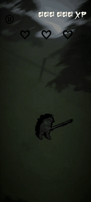
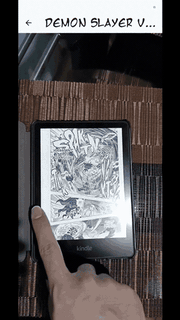
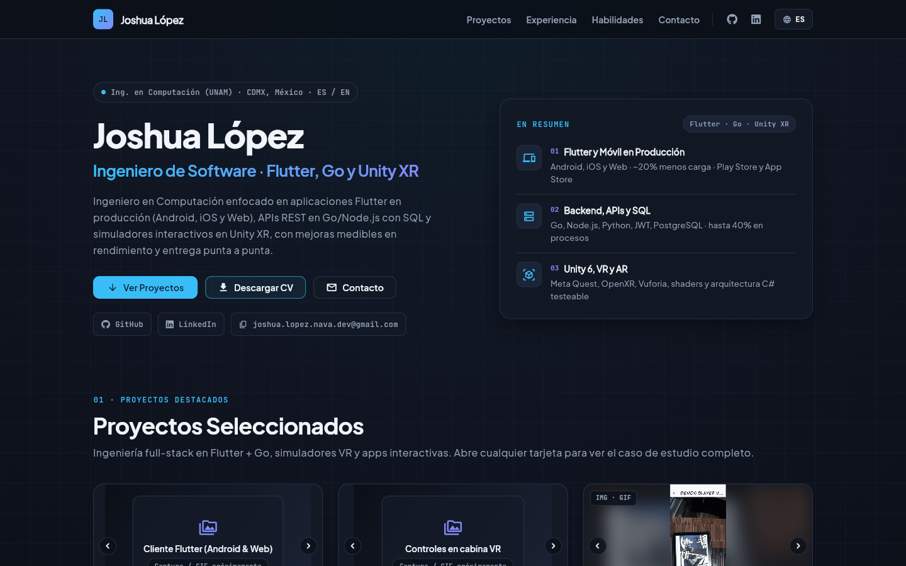

  

  <a href="https://portfolio.joshua-lopez-nava-dev.workers.dev/">PORTFOLIO</a>
  &nbsp;&nbsp;·&nbsp;&nbsp;
  <a href="https://www.linkedin.com/in/joshua-ivan-lopez-nava-77311721a">LINKEDIN</a>
  &nbsp;&nbsp;·&nbsp;&nbsp;
  <a href="mailto:joshua.lopez.nava.dev@gmail.com">EMAIL</a>

  <strong>UNAM Computer Engineering graduate</strong> &nbsp;·&nbsp; Mexico &nbsp;·&nbsp; Spanish / English

---

<table>
  <tr>
    <td width="58%" valign="top">
      <h2>Profile</h2>
      
I build cross-platform products from interface to API integration, with a focus on Flutter and Dart. My experience includes shipping mobile and web features, troubleshooting production issues, and improving performance.

    </td>
    <td width="42%" valign="top">
      <h2>At a glance</h2>
      
<strong>01</strong> &nbsp; Mobile & web product development

      
<strong>02</strong> &nbsp; REST APIs, authentication & data

      
<strong>03</strong> &nbsp; Unity, VR & augmented reality

    </td>
  </tr>
</table>

## Selected work

<table>
  <tr>
    <td valign="top">
      <h3><a href="https://github.com/JoshuaLopez2000/Forklift-VR-Simulator">VR Forklift Training Simulator</a></h3>
      
End-to-end development of an interactive VR forklift operator training simulator built in collaboration with <strong>Virtual Mind Studio (VMS)</strong>, featuring pre-operation inspection, guided driving, load-handling, and timed warehouse modules, in-cabin VR controls, optional USB wheel/pedals support, and a bilingual (ES/EN) interface. <em>(Portfolio showcase; IP belongs to VMS.)</em>

      

        
        
      

      

        
        
      

      

        
        
      

      

        
      

      UNITY &nbsp;·&nbsp; C# &nbsp;·&nbsp; VIRTUAL REALITY &nbsp;·&nbsp; SIMULATION
    </td>
  </tr>
  <tr>
    <td valign="top">
      <h3><a href="https://github.com/JoshuaLopez2000/BladesOfTheFallen">Blades of the Fallen</a></h3>
      
A mobile action game built around directional attacks, parries, and escalating enemy waves, with a Chinese ink-painting visual style.

      

      UNITY &nbsp;·&nbsp; C# &nbsp;·&nbsp; GAMEPLAY SYSTEMS
    </td>
  </tr>
  <tr>
    <td valign="top">
      <h3><a href="https://github.com/JoshuaLopez2000/mangaARExperience">Manga AR Experience</a></h3>
      
A Flutter app that brings manga pages to life with Unity and Vuforia augmented reality.

      

      

      

      FLUTTER &nbsp;·&nbsp; UNITY &nbsp;·&nbsp; VUFORIA
    </td>
  </tr>
  <tr>
    <td valign="top">
      <h3><a href="https://github.com/JoshuaLopez2000/Portfolio">Personal Portfolio</a></h3>
      
A bilingual Flutter portfolio, built for the web and deployed on Cloudflare Workers. <a href="https://portfolio.joshua-lopez-nava-dev.workers.dev/">View the live site</a>.

      

      FLUTTER &nbsp;·&nbsp; DART &nbsp;·&nbsp; WEB
    </td>
  </tr>
</table>

## Toolkit

  <strong>Mobile</strong> &nbsp; Flutter · Dart · Android · iOS · Web 
  <strong>Backend</strong> &nbsp; Go · Python · Node.js · REST APIs · JWT 
  <strong>Data & delivery</strong> &nbsp; PostgreSQL · MySQL · Docker · Git · CI/CD 
  <strong>Interactive</strong> &nbsp; Unity · C# · VR · Vuforia

---

  <a href="mailto:joshua.lopez.nava.dev@gmail.com">Have an interesting project? Let's talk.</a>

